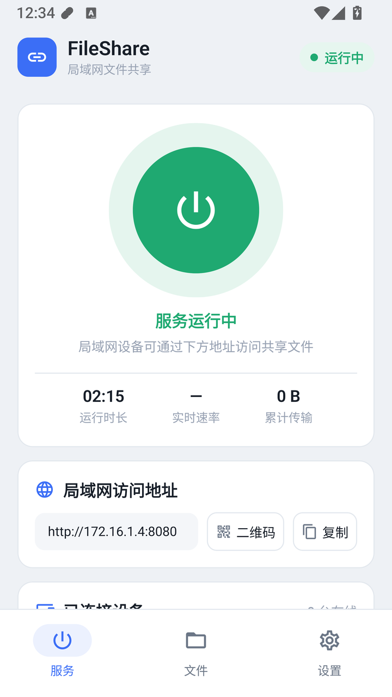
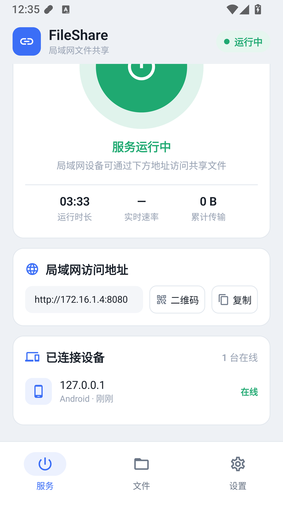
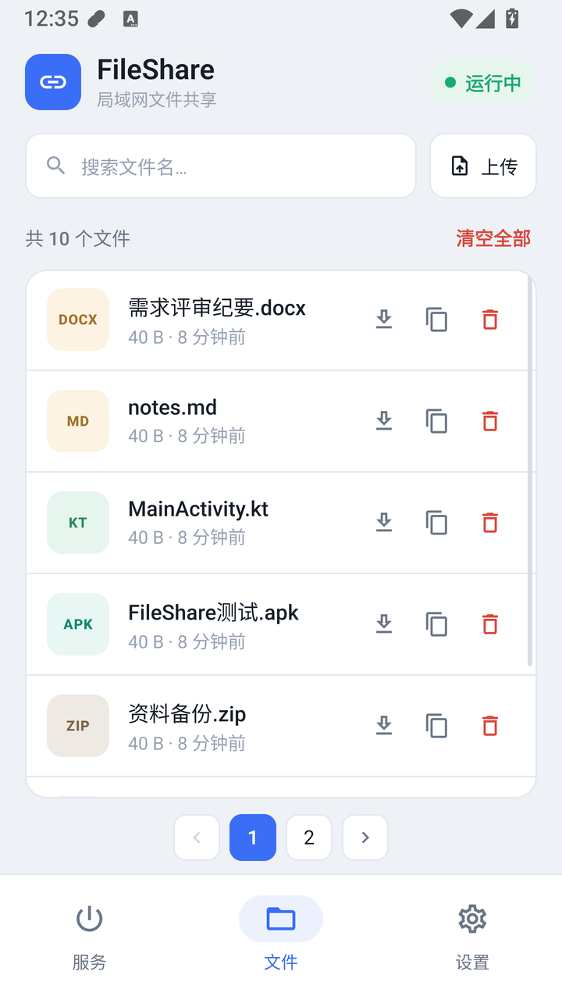
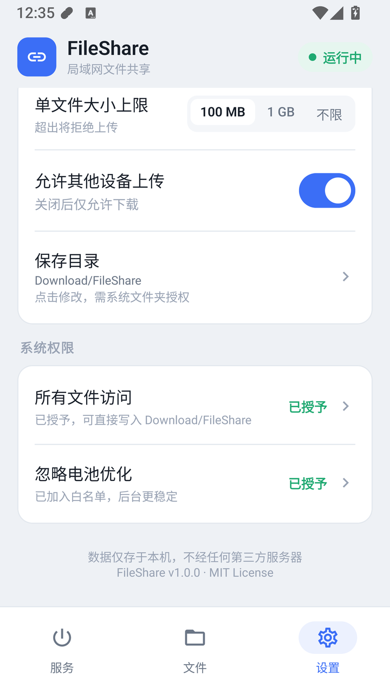
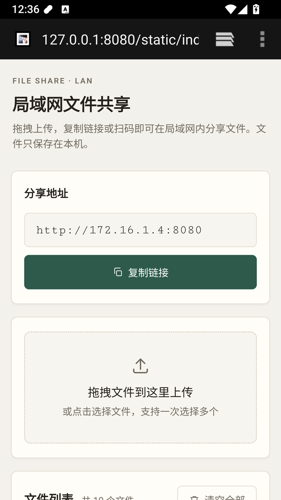

# FileShare · 局域网文件共享

> Android 一键开启局域网文件共享：手机内嵌 HTTP 服务，同一 Wi-Fi 下任何设备用浏览器上传 / 下载，文件只留在本机。
> Kotlin + Jetpack Compose + Ktor + Koin，多模块工程。



## 简介

FileShare 把手机变成一台轻量文件服务器：点击电源按钮即可启动内嵌 Ktor 服务，其他设备通过浏览器访问局域网地址（或扫码）上传、下载、删除文件，无需安装任何 App、无需登录、不经过云端。

项目同时是一套 Kotlin Android 全栈实践：Compose 三 Tab 界面、Ktor Server（HTTP + WebSocket）、Koin、DataStore、SAF / File 双存储、前台服务与开机自启，以及 build-logic 约定插件与国内镜像构建。

## 功能特性

- **一键启停**：大号电源按钮与运行呼吸灯，关闭前二次确认；前台服务常驻通知，支持开机自启与屏幕常亮。
- **局域网访问**：自动识别局域网 IP，展示访问地址 / 二维码并支持一键复制；实时显示已连接设备与在线状态。
- **文件管理**：浏览器拖拽 / 多选上传（流式写盘 + 进度）、列表搜索（150ms 防抖）、分页、下载到本机（系统另存为）、复制直链、删除 / 清空。
- **传输控制**：端口 8080 / 8000 / 9090 切换（运行中自动重启）、单文件大小上限、允许上传开关（网页端联动隐藏上传区）。
- **存储与权限**：默认 `Download/FileShare`，支持 SAF 选择任意目录；所有文件访问、忽略电池优化、通知权限引导。
- **浏览器页面**：内置 FileShareTs 同款 Web 页面，无需修改即可使用完整 API。

## 页面预览

| 服务 · 运行中 | 已连接设备 |
| --- | --- |
|  |  |

| 文件管理 | 设置与权限 |
| --- | --- |
|  |  |

| 二维码访问 | 浏览器端 |
| --- | --- |
|  |  |

更多界面见各 feature 模块 README。

## 技术栈

| 层 | 技术 |
| --- | --- |
| 语言 / 构建 | Kotlin 2.3.21 · AGP 8.13.2 · Gradle 8.14.3 · JDK 17 · compileSdk 36 / minSdk 26 |
| UI | Jetpack Compose（BOM 2026.03.01）· Material 3 · Material Icons Extended |
| 服务端 | Ktor 3.6.2（CIO / WebSocket / ContentNegotiation / StatusPages） |
| 依赖注入 | Koin 4.2.2（Compose / ViewModel） |
| 数据 | DataStore Preferences · SAF（DocumentFile）· File API |
| 其他 | kotlinx.coroutines 1.10.2 · kotlinx.serialization 1.10.0 · ZXing 3.5.3 |
| 架构 | 多模块 + build-logic 约定插件 · 阿里云 Maven 镜像 · 腾讯云 Gradle 镜像 |

## 快速开始

构建并安装到已连接的 Android 设备（Android 8.0+，SDK Platform 36）：

```powershell
.\gradlew :app:installDebug
```

只构建 APK：

```powershell
.\gradlew :app:assembleDebug
```

APK 输出：`app/build/outputs/apk/debug/app-debug.apk`。

启动 App 后点击电源按钮，其他设备连接同一 Wi-Fi，用浏览器打开界面上的地址或扫码即可。默认共享目录为 `Download/FileShare`；未授予「所有文件访问」时会自动回退到应用专属目录。

环境配置、镜像与常见问题见 [app/README.md](app/README.md)。

## 项目结构

```text
FileShareAndroid
├─ app/                     Application、MainActivity、三 Tab 导航、Manifest 与 Web 资源
├─ build-logic/             Gradle 约定插件
├─ core/
│  ├─ model/                领域模型（文件 / 设置 / 设备 / 服务状态 / 传输）
│  ├─ common/               格式化、文件名安全、UA 解析、局域网 IP
│  ├─ designsystem/         主题令牌与通用 Compose 组件
│  ├─ data/                 DataStore 设置仓库、File / SAF 存储
│  └─ server/               Ktor 服务、设备登记、控制器、前台服务
├─ feature/
│  ├─ share/                服务页
│  ├─ files/                文件页
│  └─ settings/             设置页
├─ docs/                    设计文档、原型、截图、赞助二维码
└─ gradle/                  Version Catalog 与 Gradle wrapper
```

## 模块文档

| 模块 | 文档 |
| --- | --- |
| 应用壳 / 构建 / 权限 | [app/README.md](app/README.md) |
| 领域模型 | [core/model/README.md](core/model/README.md) |
| 通用工具 | [core/common/README.md](core/common/README.md) |
| 设计系统 | [core/designsystem/README.md](core/designsystem/README.md) |
| 设置与文件存储 | [core/data/README.md](core/data/README.md) |
| Ktor 服务与 API 契约 | [core/server/README.md](core/server/README.md) |
| 服务页 | [feature/share/README.md](feature/share/README.md) |
| 文件页 | [feature/files/README.md](feature/files/README.md) |
| 设置页 | [feature/settings/README.md](feature/settings/README.md) |
| Gradle 约定插件 | [build-logic/README.md](build-logic/README.md) |

产品与交互文档：[功能清单](docs/局域网文件共享App功能清单-v1.md) · [功能设计](docs/局域网文件共享App功能设计-v1.md) · [交互原型](docs/局域网文件共享App交互原型-v1.html)

## 赞助支持

如果这个项目对你有帮助，欢迎通过爱发电支持作者。可使用支付宝或微信扫码赞助：

<p align="center">
  <a href="https://ifdian.net/a/sylvie233">
    
  </a>
</p>

爱发电主页：<https://ifdian.net/a/sylvie233>

也欢迎给项目点一个 ⭐ **Star**、提交 **Issue / PR**，或分享给需要的朋友。

## License

[MIT](LICENSE) © 2026 sylvie233
