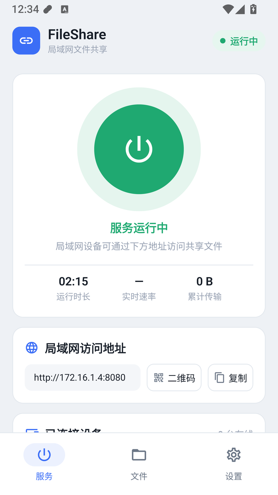
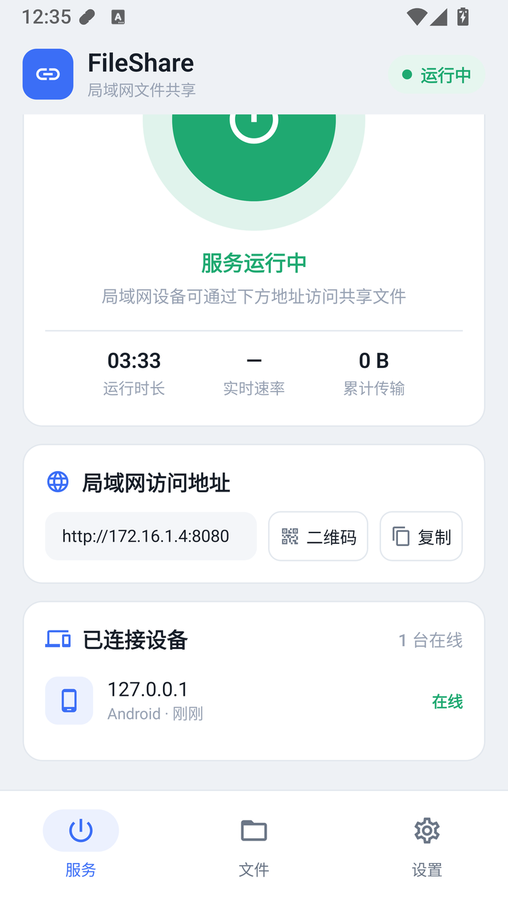

# feature:share · 服务页

对应交互原型的「服务」Tab：电源控制、局域网地址、二维码、运行指标与已连接设备。

| 服务 · 运行中 | 已连接设备 |
| --- | --- |
|  |  |

## 界面

- **电源卡片**：启动中显示进度环且不可点；运行中绿色呼吸灯；停止前弹窗确认「已连接设备将无法访问」。
- **运行指标**：运行时长、实时速率（上下行合计）、累计传输，每秒刷新。
- **访问地址**：展示 `http://<ip>:<port>`，支持复制；二维码弹窗使用 ZXing 生成，提示同局域网扫码。
- **已连接设备**：IP、设备类型（UA 解析）、最近活跃时间与在线 / 离线标签；无设备时给出引导。
- **状态横幅**：未运行、启动中、启动失败分别展示对应提示。

## 实现

`ShareViewModel` 直接映射 `ShareController` 的 `state`、`metrics`、`devices` 与 `SettingsRepository.settings`：

| 操作 | 行为 |
| --- | --- |
| 点击电源 | 未运行 → `ShareService.start()`；运行中 → 二次确认后 `ShareService.stop()` |
| 复制地址 | `ClipboardManager` 写入剪贴板并 Toast |
| 二维码 | 后台用 ZXing `QRCodeWriter` 生成 560px 位图 |
| 保留常亮提示 | 运行中且关闭了「屏幕常亮」时显示提醒横幅 |

设备图标按 `DeviceType` 映射为手机 / 平板 / 电脑 / 通用图标，设备列表由 `DeviceRegistry` 每 30 秒判定离线。
